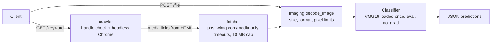

# Social image classifier

A small Flask API that puts an ImageNet label on images. It takes images from two places:

- **`POST /file`**: an image you upload.
- **`GET /keyword?keyword=<handle>`**: the media images on a public Twitter profile page. A headless Chrome renders the page and the API classifies each `pbs.twimg.com/media` image it finds.

Classification uses torchvision's pretrained **VGG19** (`IMAGENET1K_V1`). Each image gets the top-1 ImageNet-1k class from `labels.txt` and its softmax probability as a percentage. The model only knows the 1,000 ImageNet classes. It has not been evaluated on social-media photos, so treat the labels as a demo and not as measured accuracy.



## Running it

### With Docker (recommended)

```sh
docker build -t social-image-classifier .
docker run --rm -p 8000:8000 social-image-classifier
```

The image is CPU-only and runs gunicorn as an unprivileged user. Torch and torchvision come from the PyTorch CPU wheel index (`download.pytorch.org/whl/cpu`) and everything else from PyPI. **The first classification downloads the VGG19 weights (about 550 MB)** into the torch cache inside the container, so the first request is slow. To keep the weights between runs, mount a volume at `/home/app/.cache/torch`.

The image does not include Selenium or Chrome, so `/keyword` answers `503` there. `/file` and `/status` work.

### Locally (Python 3.12)

```sh
python3.12 -m venv .venv
source .venv/bin/activate
pip install --index-url https://download.pytorch.org/whl/cpu torch==2.15.0 torchvision==0.29.2
pip install -r requirements.txt            # API only
pip install -r requirements-crawler.txt    # optional: adds Selenium for /keyword (also needs Chrome)
flask --app app run
```

The API is then on `http://127.0.0.1:5000`. Selenium Manager finds or downloads a matching chromedriver by itself.

| File | Contents |
| --- | --- |
| `requirements.txt` | Runtime: Flask, torch, torchvision, Pillow, requests, Beautiful Soup, gunicorn |
| `requirements-crawler.txt` | Runtime plus Selenium, only for `/keyword` |
| `requirements-dev.txt` | Runtime plus pytest and ruff |

## API

The examples below were **captured from the offline stub server** (`tests/stub_server.py`), not from the real model. The stub always answers `sports_car, sport_car`, and its `/keyword` reads a canned profile page served by a fake media host. The response shapes and error messages are the real ones, but real VGG19 labels and probabilities will differ. To reproduce them without weights, Chrome or network access:

```sh
pip install -r requirements-dev.txt
gunicorn --bind 127.0.0.1:8000 "tests.stub_server:create_stub_app()"
```

### `GET /status`

```json
{"status": "API is up and running"}
```

### `POST /file`

Send the image as multipart form data under the key `image`.

```sh
curl -F "image=@red-car.jpg" http://127.0.0.1:8000/file
```

```json
{
  "predictions": [
    {
      "filename": "red-car.jpg",
      "label": "sports_car, sport_car",
      "probability": 74.9
    }
  ]
}
```

Uploads are decoded in memory and never written to disk. The client's filename is only echoed back, after `secure_filename()`. Rejected uploads:

| Case | Status | Body |
| --- | --- | --- |
| No `image` field | 400 | `{"message": "Please provide image with 'image' key in request"}` |
| Not an image, or truncated | 400 | `{"message": "The file is not a readable image"}` |
| Format other than JPEG/PNG/GIF/WebP/BMP | 400 | `{"message": "Unsupported image format: TIFF"}` |
| Request body over 10 MB | 413 | Werkzeug's message, as JSON |
| More than 40 megapixels | 413 | `{"message": "Image exceeds 40000000 pixels"}` |

### `GET /keyword?keyword=<handle>`

```sh
curl "http://127.0.0.1:8000/keyword?keyword=stub_demo"
```

```json
{
  "predictions": [
    {
      "filename": "StubPhotoA",
      "label": "sports_car, sport_car",
      "probability": 74.9
    },
    {
      "filename": "StubPhotoB",
      "label": "sports_car, sport_car",
      "probability": 74.9
    }
  ],
  "skipped": [
    {
      "reason": "Media host answered 404",
      "url": "https://pbs.twimg.com/media/StubMissing?format=jpg&name=small"
    }
  ]
}
```

The keyword is a profile handle (`https://twitter.com/<keyword>`), so it must be 1 to 15 letters, digits or underscores. Anything else gets a `400`. At most 10 images are classified per request. A link that is refused, fails to download or does not decode goes under `skipped` and does not fail the whole request. Without Selenium installed the endpoint answers `503`:

```json
{"message": "The crawler needs Selenium: pip install -r requirements-crawler.txt"}
```

That message was captured from the Docker image, which does not include Selenium.

Twitter/X now shows most profile pages only to logged-in users, so a real crawl often finds no media and returns an empty `predictions` list. The crawler has no login support.

### Errors

Every error is JSON with a `message` key, including 404, 405 and unexpected 500s. A 500 returns `{"message": "Something went wrong"}` and logs the traceback on the server.

## Design notes

- **One model per process.** `Classifier` builds VGG19 the first time it is needed, behind a lock, so concurrent first requests don't each load 550 MB. It runs in `eval()` mode under `torch.no_grad()`. Preprocessing follows the VGG19 recipe: resize to 256, centre-crop to 224, then ImageNet normalisation.
- **Scraped links are untrusted.** `fetcher.validate_media_url` only accepts `https://pbs.twimg.com/media/<id>` with an optional image extension and a plain query string. It rejects other schemes and hosts, credentials, ports, extra path segments and encoded `../`. Downloads have a `(5 s connect, 15 s read)` timeout, do not follow redirects and stop at 10 MB.
- **Pixel limits before decoding.** `PIL.Image.MAX_IMAGE_PIXELS` is set to 40 MP, and the header is checked before any pixels are allocated. Pillow normally only warns between 1x and 2x of that limit, but here that range is rejected too.
- **Selenium is optional.** It is imported only when `/keyword` runs, so the API and the Docker image work without a browser.
- **No shared folder.** The original version saved every image into `images/` and classified the whole folder on each request, so earlier users' images leaked into later responses. Nothing is written to disk now. `images/` is git-ignored in case an old copy is still around.

## Development

```sh
pip install -r requirements-dev.txt
pytest          # 83 tests; the model, Chrome and all HTTP fetches are stubbed
ruff check . && ruff format --check .
```

The tests never download weights or reach Twitter. They use a stub `torch.nn.Module`, synthetic Pillow images and fake HTTP sessions.

## License

MIT, see [LICENSE](LICENSE).
